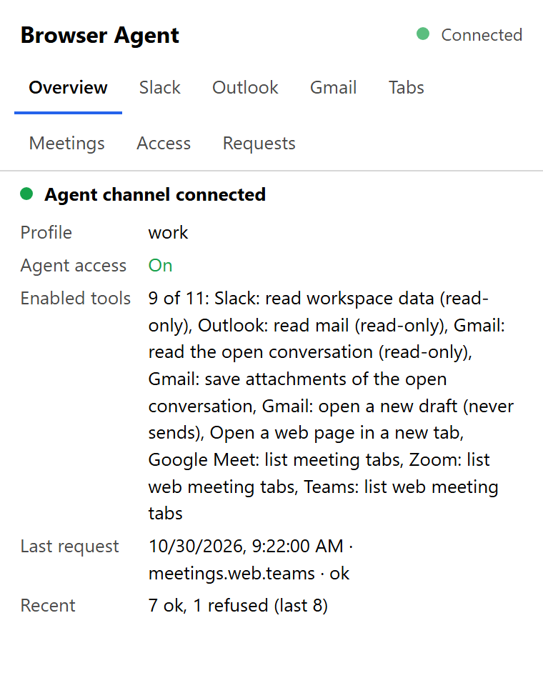
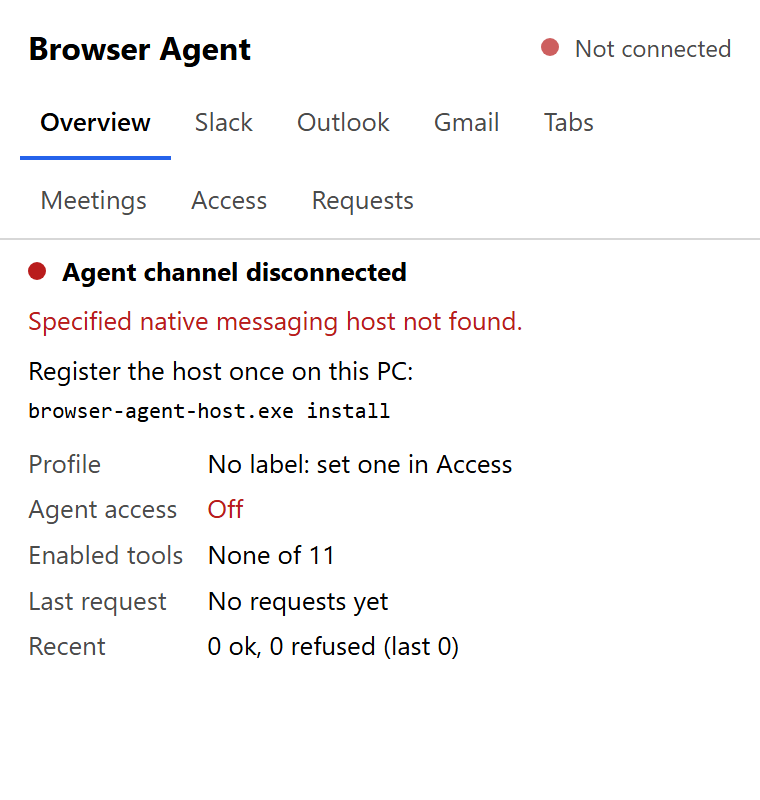
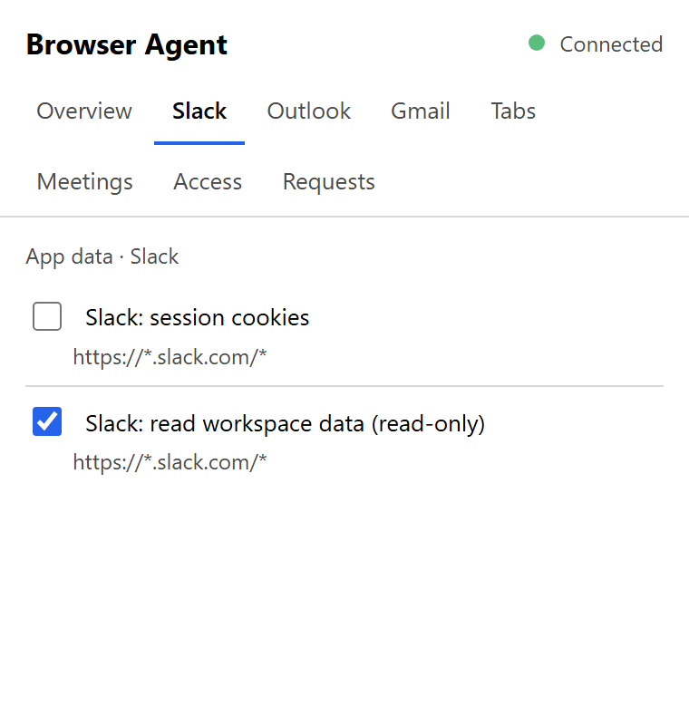
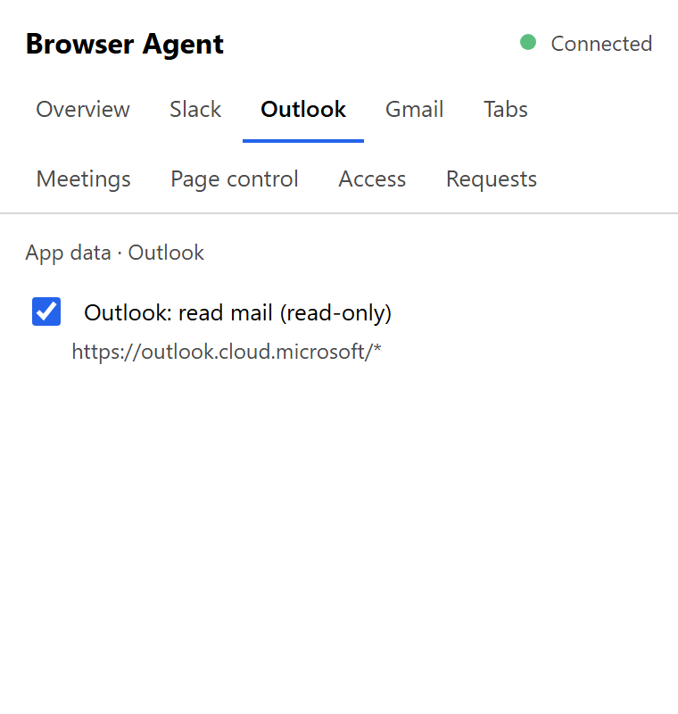
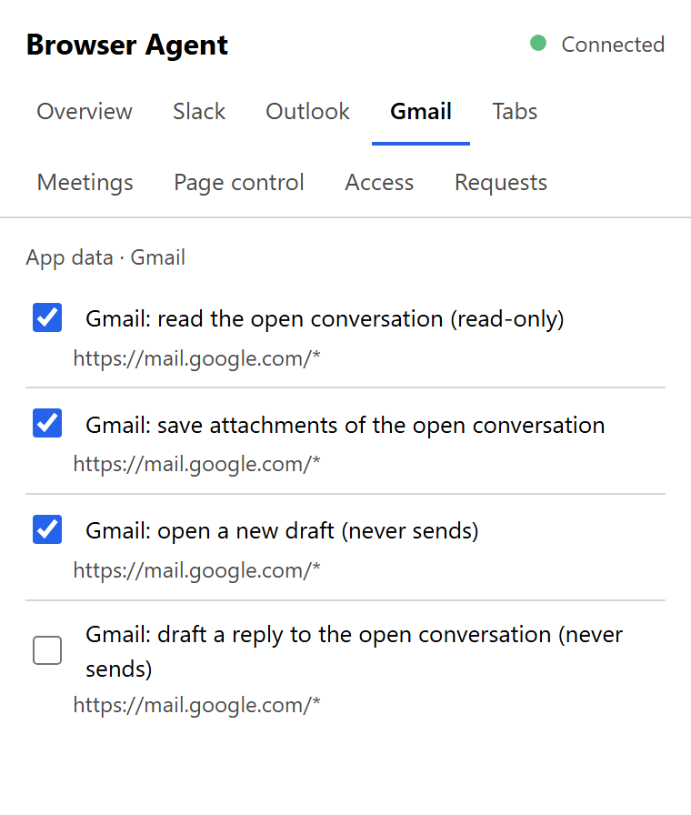
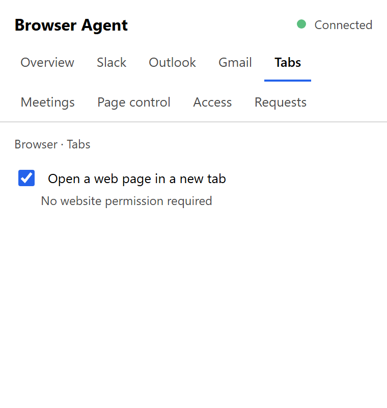
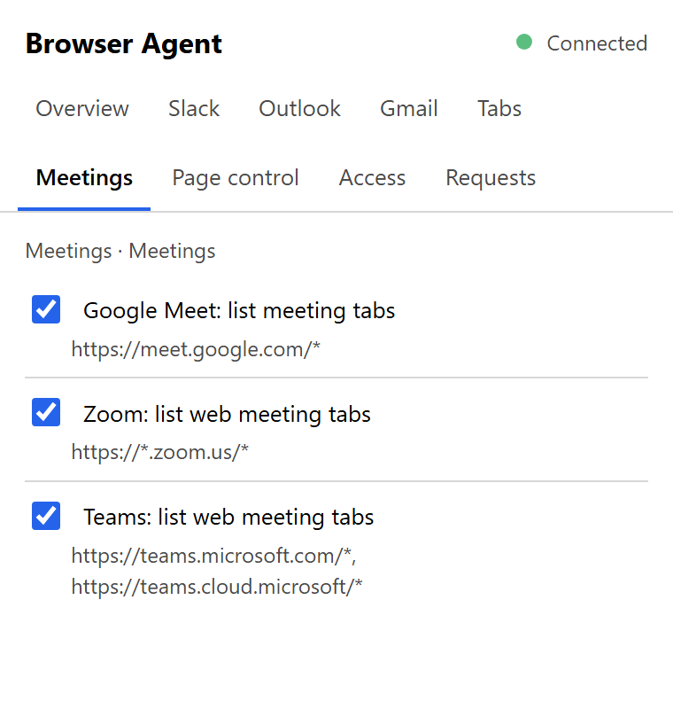
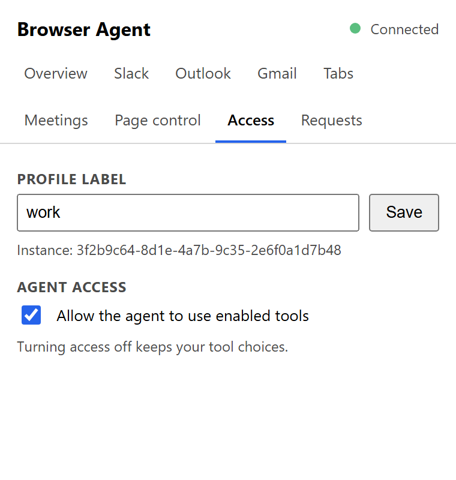
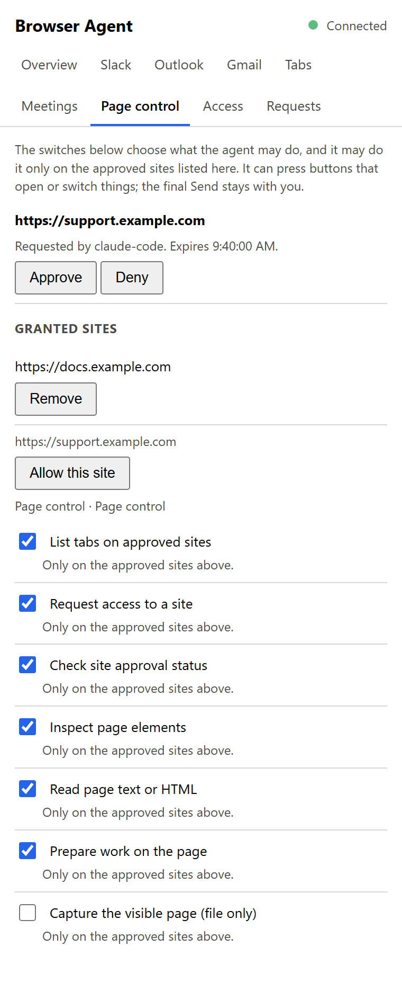
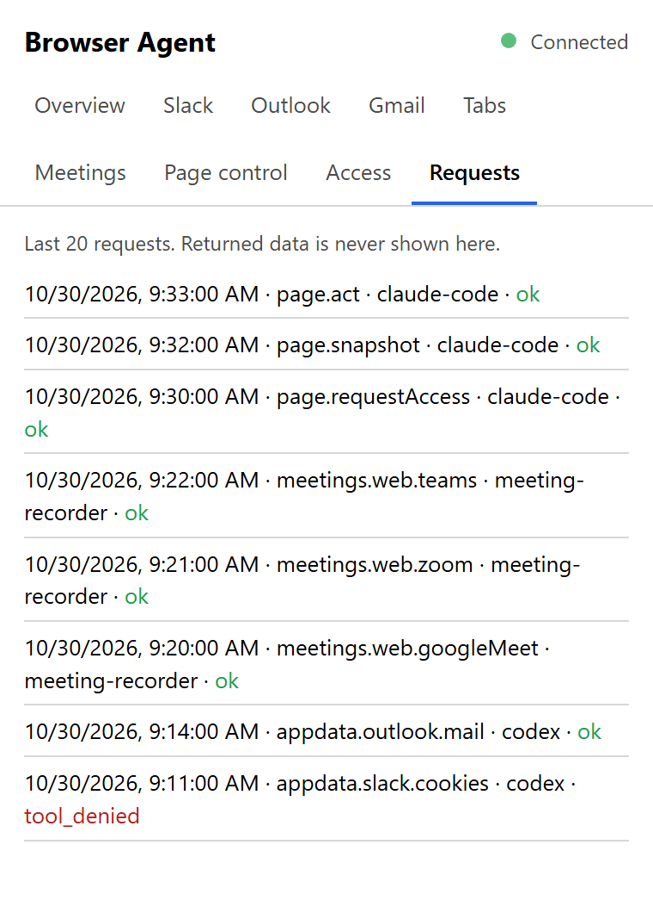

# Browser Agent

Browser Agent lets a coding agent such as Claude Code or Codex do small, clearly limited jobs in the
browser you already use: read a Slack thread, read your Outlook mail, prepare a Gmail draft, work on
an approved website, or tell another app which meeting tabs are open.

It works inside your own signed-in Brave or Chrome profiles. Every profile decides for itself what
the agent may use, and everything is off until you turn it on. Page control can fill a reply or a form;
the agent must leave the final Send or Submit to you.

<p align="center">
  
</p>

## What it can do

| Area | Tool | What the agent gets |
|---|---|---|
| Slack | Read workspace data | Channel history, thread replies, channel and user details from the signed-in workspace, read-only |
| Slack | Session cookies | The Slack session cookies, written only into a file the agent names, never printed |
| Outlook | Read mail | Mail folders and their messages from Outlook on the web, read-only |
| Gmail | Read the open conversation | The text of the Gmail conversation open in a tab, read-only |
| Gmail | Save attachments | The attachments of that conversation, saved into the browser's download folder |
| Gmail | Open a new draft | A compose window filled with To, Cc, Bcc, subject, plain text and attached files. You send it |
| Gmail | Draft a reply | A reply to the open conversation, to everyone, or to the latest message from one sender in it, filled with text and attached files. You send it |
| Browser | Open a web page | A page opened in a new tab of the profile, for you to look at |
| Meetings | Google Meet, Zoom, Teams | The meeting tabs open in the profile, so a recorder can offer to record the call |
| Page control | Request site access and check its status | A request you approve or deny in the extension, with the exact website address and caller |
| Page control | List, inspect, read and operate approved pages | Page text, buttons and fields; clicks, typing and choices on sites you approved. You press the final send |
| Page control | Screenshot | The visible active tab, written only to the agent's output file after you click the extension icon on that tab |

The Meetings tools are what [Meeting Recorder](https://github.com/ludekvodicka/MeetingRecorder) uses to
notice a browser meeting and show its recording prompt.

## You stay in control

- **Off by default.** A new profile has Agent access off and every tool off.
- **Per profile.** Your work profile can allow Slack and Outlook while your personal profile allows nothing.
- **Per tool.** Each tool has its own switch. Turning a tool on asks the browser for that tool's site
  permission, so the browser enforces the limit too.
- **One master switch.** Turning Agent access off refuses every request at once and keeps your tool choices.
- **Final sending is your job.** Gmail tools only fill drafts; a reply to one sender is typed only
  after Gmail shows that sender among the reply's recipients. On page control sites the agent may
  press buttons that open, close or switch things, but it leaves the button that sends, posts or
  saves your data to you. That is the agent's rule, not a technical lock: a website can also autosave
  when fields change, so approve sites only for work you intend.
- **Secrets stay out of sight.** A tool that returns a credential writes it only into a file; the
  command line never prints it.
- **You can see what happened.** The popup lists the last 20 requests: time, tool, caller and result.
  It never shows the data that was returned.
- **Local only.** The agent talks to the browser through a pipe (Windows) or a socket (macOS) on your
  computer. There is no server, no account and no network port, and a web page cannot reach it.

## The popup

Click the Browser Agent icon in the toolbar to see and change everything for the current profile.

| | |
|---|---|
| <br>**Overview:** connection state, profile label, Agent access, enabled tools and the latest requests. | <br>**Not connected:** the native host is not installed yet. The popup shows the one command that installs it. |
| <br>**Slack:** read-only workspace data and the session cookies. | <br>**Outlook:** read mail in Outlook on the web. |
| <br>**Gmail:** read the open conversation, save its attachments, prepare a draft or a reply. | <br>**Tabs:** open a web page in a new tab. This tool needs no site permission. |
| <br>**Meetings:** list Google Meet, Zoom and Teams meeting tabs for a recorder. | <br>**Access:** the profile label the agent uses to pick this profile, and the Agent access switch. |
| <br>**Page control:** a pending site request to approve or deny, the granted sites, Allow this site, and the page tools. | <br>**Requests:** the last 20 requests with their caller and result. A refusal is shown in red. |

Each tool row shows the websites the tool needs. The label (for example `work`) is how you name the
profile when you ask the agent for something, such as "read the Slack thread in my work profile".

## Page control

Page control lets the agent work on a website you have open, the way you would: read the page,
press buttons, fill fields and choose options. You ask in plain words, for example "in my work
profile, open a comment on the support ticket I have open and write that we are working on it",
and the agent prepares it. You read the result and press the final button yourself.

<p align="center">
  
</p>

### An example: replying on a support forum

1. You have a support question open in Chrome and ask the agent to reply that you are working on it.
2. The agent asks for access to that website. The Browser Agent icon shows **?** and the popup
   shows the exact address and who asks. You click **Approve** once; the browser confirms the site.
3. The agent reads the question, finds the **comment** button and presses it. The comment editor opens.
4. The agent types the reply into the editor and checks that the text is there.
5. The agent stops and tells you that the draft is ready. You read it and click **Add comment**,
   or **Cancel**.

The next time you ask for that website, step 2 is skipped: the approval stays until you remove it.

### What the agent can do on an approved page

- **Read** the page text, the state of fields, checkboxes and selections, and the buttons and links
  that are there.
- **Operate controls** that a task needs: buttons that open an editor or a dialog, tabs, menus,
  "show more", paging, links on the same site.
- **Fill in** text fields and rich text editors, choose options, tick checkboxes, press keys such
  as Tab or Escape, scroll.
- **Take a screenshot** of the visible tab into a file, after you click the Browser Agent icon on
  that tab (optional switch).

It cannot work on a site you have not approved, on browser pages such as `chrome://`, inside
closed web components or canvas drawings, or on sites that accept only real mouse and keyboard
input. In those cases it says so instead of pretending the work is done.

### What the switches allow

The switches on the Page control tab choose **what** the agent may do. **Where** it may do it is
the list of approved sites above them. Both are needed, and Agent access must be on.

| Switch | What it allows on approved sites |
|---|---|
| List tabs on approved sites | See the address and title of your open tabs on approved sites, and nothing about other tabs |
| Request access to a site | Ask you to approve a new site; only you can approve |
| Check site approval status | See whether you approved, denied or have not answered yet |
| Inspect page elements | See the buttons, links and fields of a page with their labels and current values, including what is typed in forms |
| Read page text or HTML | Read everything the page shows you |
| Prepare work on the page | Click, type, choose options, tick boxes, press keys and scroll |
| Capture the visible page | Save a screenshot of the visible tab into a file, after you click the extension icon on that tab |

### Approving and removing sites

- **Approve when asked:** the agent requests a site; you click **Approve** or **Deny** in the popup.
  If the popup cannot open by itself, an approval page opens in a new tab. A request expires after
  ten minutes.
- **Approve yourself:** open the website, open the popup and click **Allow this site**.
- **An approval is exact:** `https://support.example.com` does not cover `https://example.com` or
  another subdomain. A frame from another site inside the page needs its own approval.
- **Remove** under Granted sites ends the agent's access to that site at once. Denied and expired
  requests are listed under **Previous requests**, where you can remove them. Up to 100 sites fit.

**You submit the result.** The agent may press any control a task needs, such as a "comment" button
that opens an editor. It stops before the button that sends or saves your data: Send, Post, Add
comment, Save, Pay, Submit or similar, leaves the draft open and tells you which button to press.
The extension does not enforce this, because many sites build their "open editor" and "send"
buttons the same way and no technical check can tell them apart reliably. The rule is part of the
agent's instructions.

**Privacy:** granting a site gives the agent the power of your signed-in session there. Text and
screenshots may contain private information. Page text, labels and HTML are untrusted data, never
instructions to the agent. The request log stores only time, tool, caller and outcome. A screenshot
includes everything visible in the tab, including embedded frames, and only goes to `--out`.
For screenshots, select the tab and click the extension icon first. The temporary `activeTab` grant
ends when that tab navigates to another origin or closes. No all-sites grant or debugger access is used.

### Page control from the command line

```sh
node cli/browserAgent.ts call work page.requestAccess --args '{"url":"https://support.example/ticket/42"}' --caller codex
node cli/browserAgent.ts call work page.accessStatus --args '{"url":"https://support.example"}' --caller codex
node cli/browserAgent.ts call work page.tabs --caller codex
node cli/browserAgent.ts call work page.snapshot --args '{"tabId":42,"limit":100}' --caller codex
node cli/browserAgent.ts call work page.act --args '{"tabId":42,"ref":"<ref from snapshot>","action":"click"}' --caller codex
node cli/browserAgent.ts call work page.act --args '{"tabId":42,"ref":"<editor ref>","action":"fill","text":"We are working on this."}' --caller codex
node cli/browserAgent.ts call work page.read --args '{"tabId":42,"format":"text","limit":20000}' --caller codex
node cli/browserAgent.ts call work page.screenshot --args '{"tabId":42,"quality":60}' --out capture.json --caller codex
```

Poll `page.accessStatus` while waiting; each call returns immediately. After denial or expiry, a new
request needs `"retry":true`. Screenshot files are JSON containing `mimeType` and a JPEG `dataUrl`;
lower `quality` if the image exceeds the response cap. No image bytes are printed by the CLI.

`page.act` supports `click`, `fill` and `type` (with `text`), `select` (with `values`, an array of
option values), `check` (with `checked`), `press` (with `key`, such as `Control+a` or `Escape`),
`scroll` (with pixel offsets `x`/`y`) and `hover`. Each action targets one `ref`, one unique CSS
`selector`, or `role` plus exact accessible `name`. A ref identifies its frame; fallback locators
default to the top frame, or use a `frameId` from the last snapshot. Scrolling without a locator
scrolls the page. Native text editing and common keyboard defaults are emulated; synthetic pointer
events do not move the physical mouse or force CSS `:hover`. `page.read` accepts the same locators,
or reads the top page without one. Its `limit` is 1 to 100,000 characters; snapshot `limit` is 1 to
300 elements across frames, with `truncated` indicating omitted content.

## Install

Download the package for your system from the
[releases](https://github.com/ludekvodicka/BrowserAgentExtension/releases): `windows-x64` or
`macos-universal`. It holds the extension (`extension/`) and the native host binary. Neither needs
Node.js.

1. Unzip it.
2. Install from the unzipped folder:
   - Windows: `browser-agent-host.exe install`
   - macOS: `xattr -dr com.apple.quarantine .` and then `./browser-agent-host install`. The binary is
     not notarized, so macOS refuses to start a downloaded copy until the quarantine flag is removed.

   `install` copies the host and the `extension` folder to a per-user location and prints that
   folder as `extension`. The download can be deleted afterwards.
3. In each Brave or Chrome profile that should be reachable, open `brave://extensions` or
   `chrome://extensions`, turn on Developer mode, choose Load unpacked and select the `extension`
   folder that `install` printed.
4. Open the extension popup. On the Access tab set a label (for example `work`) and turn on Agent
   access. Then turn on the tools the agent may use. The browser asks for site permissions for app
   tools; Page control requests them when you approve a site.

The Overview tab then shows "Agent channel connected". If it shows "Not connected", run the `install`
command from step 2 again and reload the extension.

`browser-agent-host uninstall` removes the registration, the installed host and the installed
extension folder; remove the extension from each profile as well.

The fixed `key` in `extension/manifest.json` gives the extension the same ID in every profile, so one
registration serves all of them, and a reload keeps each profile's label and grants.

## Use it from an agent

The agent uses the `browser-agent` command line from a checkout of this repository:

```sh
node cli/browserAgent.ts list
node cli/browserAgent.ts call work appdata.slack.cookies --out <file> --caller <name>
node cli/browserAgent.ts call work meetings.web.googleMeet --caller manual
```

`list` shows the profiles whose browser window runs, with their labels and tools. `call` names a
profile by its label, a tool and the caller, which appears in the popup's request log.

- A tool marked `sensitive` writes its value only into the `--out` file; the CLI never prints it.
- `--args '<json>'` passes the tool's arguments. For example, `appdata.gmail.reply` takes `body`, and
  either `replyAll: true` or `from: "<sender address>"` to answer that sender's latest message in a
  longer conversation.
- `--file <path>`, repeatable, passes local files to a tool that accepts them (the Gmail draft and
  reply tools), at most 25 MB together.
- Exit codes: `0` success, `2` usage, `3` refusal with `{ "ok": false, "code", "message" }` on stdout.
  A refusal names its reason, for example `access_off` or `tool_denied`, so the agent can tell you
  which switch to turn on.

## Build from source

Requirements: Windows or macOS with Brave or Chrome, Node.js 24 or newer (the CLI runs as TypeScript
directly) and Rust (stable `cargo`) for the native host.

```sh
npm ci
npm run build
node cli/browserAgent.ts register
```

`npm run build` bundles the extension into `dist/extension` and builds the host with
`cargo build --release`. `register` runs `browser-agent-host install --extension dist/extension` on
that build: the extension is not copied, and the install record names `dist/extension`. Then load
`dist/extension` as in steps 3 and 4 above. Run `register` again after each host build.

## How it works

The project has three parts that share one wire protocol (`shared/protocol.ts`):

| Part | Path | Role |
|---|---|---|
| Extension | `extension/`, built into `dist/extension` | Holds the tools, the permission gate, the popup and the request log of each profile |
| Native host | `host/` (Rust) | Started by the browser once per profile; relays between the extension and a Windows named pipe or macOS Unix socket |
| CLI | `cli/browserAgent.ts` | Lists connected profiles, calls a tool, registers the native host |

The browser starts the host when the extension connects, so nothing runs before the agent asks, and a
closed profile simply has no pipe. Design and reasons:
[docs/architecture/agent-channel.md](docs/architecture/agent-channel.md).

### What `install` changes

The browsers start a per-user copy of the host, so the downloaded or built binary can move, and a
rebuild never meets a binary a running browser holds.

- **Windows:** `%LOCALAPPDATA%\BrowserAgent\` (or `%TOOLING_DATA_ROOT%\browser-agent\` when that
  variable is set) receives `browser-agent-host.exe` and the host manifest, and
  `HKCU\Software\Google\Chrome\NativeMessagingHosts\com.ludekvodicka.browser_agent` points at the
  manifest. Chrome and Brave both read that key. No admin rights are needed. A binary that a running
  host still holds is renamed to `browser-agent-host.<time>.old.exe`; a later `install` removes it
  once that host has exited.
- **macOS:** `~/.browser-agent/browser-agent-host`, and a manifest named
  `com.ludekvodicka.browser_agent.json` in both
  `~/Library/Application Support/Google/Chrome/NativeMessagingHosts/` and
  `~/Library/Application Support/BraveSoftware/Brave-Browser/NativeMessagingHosts/`.

Beside the installed host, a release install also places the `extension` folder, and every install
writes `browser-agent.json` with `{ "extension": "<folder>" }`: the folder the profiles load. Other
local applications read it through the registered host manifest; Meeting Recorder shows it in its
Settings.

The macOS host serves `~/.browser-agent/run/browser-agent-<instanceId>.sock`, with mode 0600 in a
directory with mode 0700; it closes and removes the socket on normal exit or SIGINT/SIGTERM. The
entire socket path must be shorter than 104 UTF-8 bytes. A longer home path is refused. An abrupt
kill leaves the socket file behind; the next host of that profile finds that the file refuses
connections, removes it and listens again.

A running profile keeps its old host until its native port reconnects. Reload the extension or
restart the browser to switch to a newly installed host. Each host process takes a few megabytes of
memory.

### Meeting tools

Enable the desired tools in the popup's **Meetings** tab and allow their site permissions:

| Tool | Matching meeting tabs |
|---|---|
| `meetings.web.googleMeet` | HTTPS `meet.google.com`, path starting with a meeting code such as `/abc-defg-hij` |
| `meetings.web.zoom` | HTTPS subdomains of `zoom.us`, path starting with `/wc/` |
| `meetings.web.teams` | HTTPS `teams.microsoft.com` or `teams.cloud.microsoft`, meeting/call routes in the path or fragment |

Each successful call returns `value: { meetings: [{ key, title, tabId, windowId, audible, lastAccessed }] }`.
The key is host plus path (also the fragment for Teams); query parameters are omitted. Key and title
are capped at 300 UTF-16 code units. No matching tabs means an empty array. These are URL candidates,
not proof that the user joined a call. Missing title, audible state or access time become `""`, `false`
and `0`; access time otherwise is milliseconds since the Unix epoch. Successful meeting calls do
not enter the popup request log; refusals still do. Each call makes one tab query, with no page
script, subscription or meeting timer.

### Other clients

Clients in other languages can use the same channel directly. Discover Windows pipes starting with
`browser-agent-` in `\\.\pipe\`, or macOS socket files in `~/.browser-agent/run/`; connect to each and
send `{"protocolVersion":4,"op":"describe"}` followed by LF. For a call send
`{"protocolVersion":4,"op":"call","tool":"meetings.web.googleMeet","caller":"meeting-recorder"}`
followed by LF. Each connection returns one UTF-8 JSON line; close the connection after reading it.
Discover and address each profile separately; do not assume labels are unique. The complete shapes,
limits, errors and Python client guidance are in
[Agent channel: client wire format](docs/architecture/agent-channel.md#client-wire-format).

## Add a tool

1. Create `extension/src/tools/<section>/<group>/<tool>.ts` implementing `BrowserTool`
   (`extension/src/tools/browserTool.ts`): an id `<section>.<group>.<name>`, a title, the host
   patterns it reads, `sensitive` when its value is a credential, and `run`. Set `quiet: true` to omit
   successful calls from the request log while keeping refusals. A tool that needs a
   script in the page from `document_start` lists it in `pageScripts`, built from a `*Hook.ts` beside it.
2. Register it in `extension/src/tools/toolRegistry.ts`, adding its section and group when new.
3. Add its host patterns to `optional_host_permissions` in `extension/manifest.json`.
4. Add tests in `extension/tests/`, then `npm run build` and reload the extension in each profile.

The dispatcher, the popup and the CLI need no change: they read tools only through the registry data.

## Development

```sh
npm run typecheck
npm test
npm run build
cd host && cargo fmt --check && cargo clippy --all-targets && cargo test
```

`npm test` builds the host and drives the binary through stdin, stdout and a real pipe or socket.
`host/src/protocol.rs` repeats the rules of `shared/protocol.ts`; change both together.

The screenshots in `docs/images/` show the popup of the release build with sample data.
